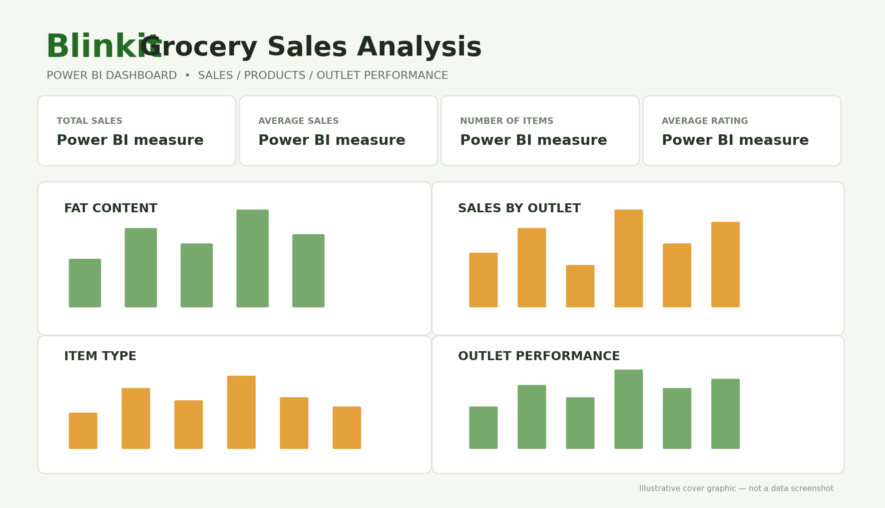

# Blinkit Grocery Sales Analysis (Power BI)

An interactive Power BI dashboard project for exploring grocery sales, product mix, and outlet performance using the **BlinkIT Grocery Data** model.



> The preview image is an illustrative project cover, not a screenshot of the report. Open the `.pbix` file in Power BI Desktop to view the actual dashboard.

## Project overview

This report brings key grocery retail metrics and outlet/product dimensions into one interactive view. It is designed to help explore sales performance and compare product and outlet segments.

## Dashboard contents

The uploaded Power BI report contains visuals for:

- **KPI cards:** Total Sales, Avg Sales, No of items, Avg Rating
- **Fat Content:** donut chart
- **Fat by Outlet:** clustered bar chart
- **Item Type:** bar chart
- **Outlet Establishment:** line chart
- **Outlet Size:** donut chart
- **Outlet Location:** funnel visual
- **Outlet-level detail:** table
- **Filters / slicers:** metrics, outlet location type, outlet size, and item-related filtering

## Data fields and measures

The report model references the following fields:

| Type | Fields |
|---|---|
| Dimensions | Item Fat Content, Item Type, Outlet Establishment Year, Outlet Location Type, Outlet Size, Outlet Type |
| Measures | Total Sales, Avg Sales, No of items, Avg Rating |

Measure calculations and formatting are maintained inside the Power BI file.

## Tools

- Microsoft Power BI Desktop
- Power Query / Power BI data model (as used in the PBIX)

## How to open

1. Download or clone this repository.
2. Install [Power BI Desktop](https://www.microsoft.com/power-platform/products/power-bi/desktop).
3. Open `Blinkit_Grocery_Sales_Analysis.pbix`.
4. Use the slicers and visuals to explore the report.

## Repository structure

```text
blinkit-grocery-sales-analysis/
├── Blinkit_Grocery_Sales_Analysis.pbix
├── README.md
├── DATA_DICTIONARY.md
├── LICENSE
├── .gitignore
└── images/
    └── dashboard-preview.png
```

## Notes

- The PBIX file is the main deliverable and contains the report definition and embedded model data.
- This repository does not include a separate source CSV because the original source file was not supplied separately.
- No license is included. Add a license only if you own or have permission to license the report, documentation, and any included data. Confirm data-source permissions before redistributing the PBIX or underlying dataset.
- The preview graphic is illustrative; it does not represent actual values from the report.

## Author

Add your name and LinkedIn / portfolio links here.
